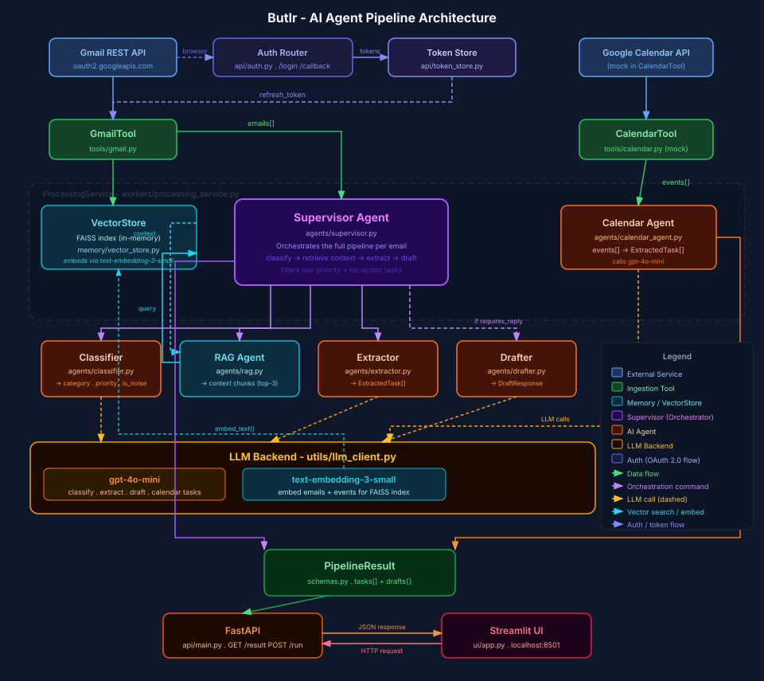

# Butlr

Butlr is a FastAPI-based assistant that monitors Gmail and Google Calendar, extracts actionable work, generates draft replies, and surfaces the results in a lightweight web dashboard. The application combines Google API integrations, a multi-agent processing pipeline, and retrieval-augmented context from a local FAISS vector store.



## What It Does

- Reads inbox messages from Gmail using OAuth 2.0.
- Pulls upcoming Google Calendar events on the same authenticated account.
- Classifies messages, extracts tasks, retrieves supporting context, and produces draft replies through an LLM-backed agent pipeline.
- Stores embedded message content locally for retrieval-augmented generation (RAG).
- Serves a simple dashboard and JSON API for reviewing the latest processing result.
- Polls Gmail on a configurable interval and retains prior task cards across runs.

## Architecture

The repository is organized into a small number of focused modules:

```text
Butlr/
├── agents/                Multi-step task extraction, drafting, orchestration, and RAG
├── api/                   FastAPI app, OAuth routes, and token persistence
├── config/                Environment-driven application settings
├── frontend/              Static dashboard assets served by FastAPI
├── memory/                Embeddings and FAISS-backed vector storage
├── models/                Shared Pydantic schemas
├── scripts/               Local development and token bootstrap helpers
├── tools/                 Gmail and Calendar API integrations
├── utils/                 Logging and LLM provider client logic
├── workers/               Background polling and processing service
└── tests/                 Automated test coverage
```

## Requirements

- Python 3.11 or newer recommended
- A Google Cloud project with:
  - Gmail API enabled
  - Google Calendar API enabled
  - An OAuth 2.0 client configured for `http://localhost:8000/auth/callback`
- At least one supported LLM provider API key:
  - OpenAI
  - Anthropic
  - Gemini
  - Groq

## Configuration

Copy `.env.example` to `.env` and fill in the required values.

Key settings:

- `LLM_PROVIDER`: `openai`, `anthropic`, `gemini`, or `groq`
- `OPENAI_API_KEY` / `ANTHROPIC_API_KEY` / `GEMINI_API_KEY` / `GROQ_API_KEY`
- `GMAIL_OAUTH_CLIENT_ID`
- `GMAIL_OAUTH_CLIENT_SECRET`
- `GMAIL_OAUTH_REDIRECT_URI`
- `GMAIL_OAUTH_REFRESH_TOKEN` (optional for headless startup)
- `GMAIL_QUERY`
- `GMAIL_LABEL_IDS`
- `GMAIL_MAX_RESULTS`
- `GMAIL_POLL_INTERVAL_SECONDS`
- `CALENDAR_LOOKAHEAD_DAYS`
- `BUTLR_TOKEN_KEY` (optional encryption key for token storage)

## Local Development

Install dependencies and start the API server:

```bash
python -m venv .venv
source .venv/bin/activate
pip install -r requirements.txt
make dev
```

The development server runs at `http://127.0.0.1:8000` with auto-reload enabled.

## Authentication Flow

Butlr supports two ways to authenticate with Google:

### Browser-based OAuth

1. Start the server with `make dev`.
2. Open `http://localhost:8000`.
3. Use the dashboard's connect flow, which starts at `/auth/login`.
4. Complete Google consent and return to `/auth/callback`.

### Headless Bootstrap

If you prefer to avoid the browser flow at runtime, generate a refresh token once and place it in `.env` as `GMAIL_OAUTH_REFRESH_TOKEN`.

```bash
python scripts/get_refresh_token.py
```

When a refresh token is present, Butlr starts in an authenticated state automatically.

## Runtime Behavior

- The processing service starts with the FastAPI application lifecycle.
- Gmail is polled on `GMAIL_POLL_INTERVAL_SECONDS`, with a minimum effective interval of 15 seconds in the API response.
- New email bodies are embedded into a local FAISS store under `.butlr_store/`.
- Processed Gmail and Calendar item IDs are persisted in `.butlr_processed`.
- OAuth tokens are stored locally through the token store and may be encrypted with `BUTLR_TOKEN_KEY`.
- Task cards from prior runs are preserved unless replaced by newer results with the same task IDs.

## API Endpoints

Primary endpoints exposed by the application:

- `GET /` serves the dashboard
- `GET /result` returns the latest cached processing snapshot and triggers an initial run if needed
- `POST /run` forces an immediate processing run
- `GET /auth/login` starts Google OAuth
- `GET /auth/callback` completes Google OAuth
- `GET /auth/status` returns authentication state
- `POST /auth/logout` clears stored credentials

## Testing

Run the test suite with:

```bash
pytest
```

## Notes for Production Use

- The current application is optimized for local development and single-process execution.
- OAuth state and token handling are implemented for a single running instance.
- Local persistence files such as `.butlr_store`, `.butlr_processed`, `.butlr_tokens`, and `.butlr_key` should be managed explicitly in deployed environments.
